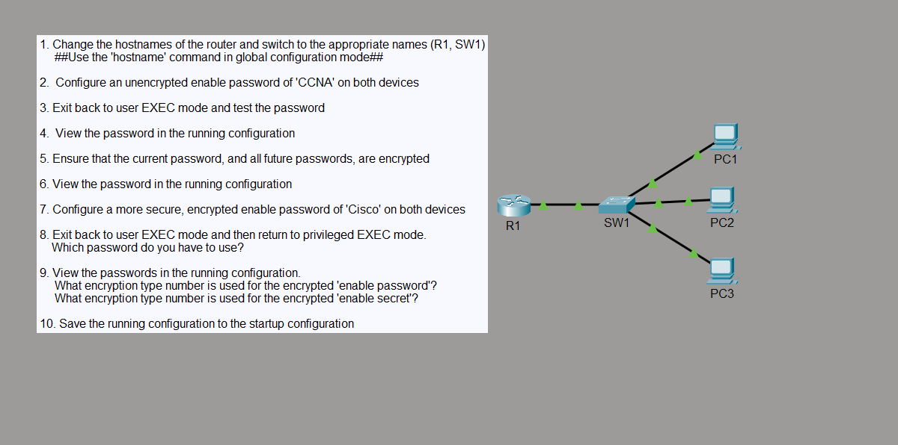
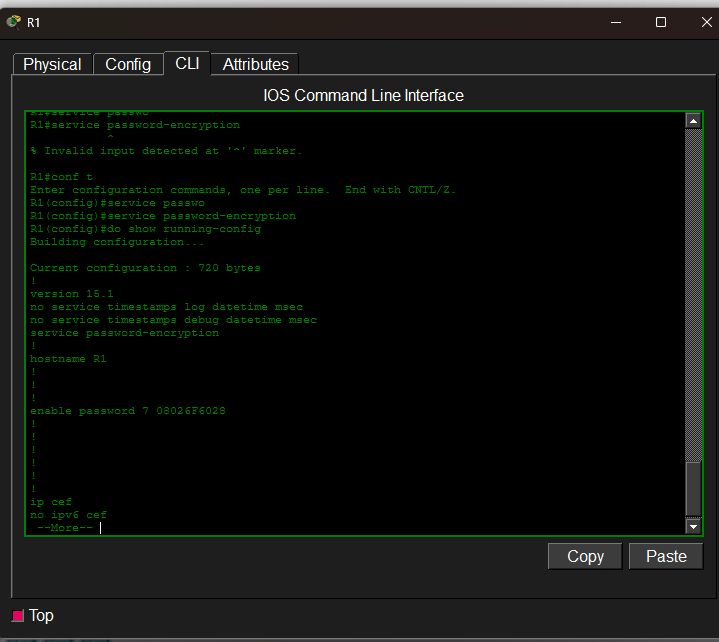

# Базовая настройка Cisco IOS и защита паролей

Базовая лабораторная работа по Cisco IOS CLI: настройка имён устройств, установка паролей для привилегированного режима (`privileged EXEC`), включение шифрования паролей и сравнение механизмов `enable password` и `enable secret`.

## Топология



* **Устройства:** 1 маршрутизатор (`R1` — Cisco 2911), 1 коммутатор (`SW1`), 3 ПК (`PC1`, `PC2`, `PC3`)
* **Среда:** Cisco Packet Tracer

## Задачи

1. Настроить имена устройств (`R1`, `SW1`).
2. Задать незашифрованный пароль для привилегированного режима (`CCNA`) и проверить вход.
3. Включить глобальное шифрование паролей (`service password-encryption`).
4. Настроить более надёжный хешированный пароль (`enable secret Cisco`).
5. Сравнить типы шифрования в `running-config` и проверить приоритет паролей.
6. Сохранить текущую конфигурацию в NVRAM (`startup-config`).

## Конфигурация

### Маршрутизатор `R1`

```cisco
Router> enable
Router# configure terminal
Router(config)# hostname R1

! Установка незашифрованного пароля на privileged EXEC
R1(config)# enable password CCNA

! Шифрование всех текущих и будущих открытых паролей (Type 7)
R1(config)# service password-encryption

! Установка более надёжного пароля с хешированием (Type 5)
R1(config)# enable secret Cisco

! Сохранение конфигурации в NVRAM
R1(config)# end
R1# copy running-config startup-config
```

### Коммутатор `SW1`

```cisco
Switch> enable
Switch# configure terminal
Switch(config)# hostname SW1

! Установка незашифрованного пароля на privileged EXEC
SW1(config)# enable password CCNA

! Шифрование всех текущих и будущих открытых паролей (Type 7)
SW1(config)# service password-encryption

! Установка более надёжного пароля с хешированием (Type 5)
SW1(config)# enable secret Cisco

! Сохранение конфигурации в NVRAM
SW1(config)# end
SW1# copy running-config startup-config
```

## Проверка и ответы на вопросы

### 1. Незашифрованный и зашифрованный `enable password`

До включения `service password-encryption` пароль хранится в `running-config` в открытом виде:

```cisco
no service password-encryption
!
hostname R1
!
enable password CCNA
```

После включения `service password-encryption` Cisco IOS применяет обратимое шифрование Type 7:

```cisco
service password-encryption
!
hostname R1
!
enable password 7 08026F6028
```



### 2. Ответы на вопросы по лабе

* **Какой пароль нужно использовать, если настроены оба (`enable password` и `enable secret`)?**  
  `Cisco` (`enable secret`). При наличии обоих параметров `enable secret` всегда имеет приоритет над `enable password`.
* **Какой номер типа шифрования используется для зашифрованного `enable password`?**  
  **Type 7** (слабое, легко обратимое проприетарное шифрование Cisco, применяемое командой `service password-encryption`).
* **Какой номер типа шифрования используется для `enable secret`?**  
  **Type 5** (хеш MD5 — значительно надёжнее Type 7).