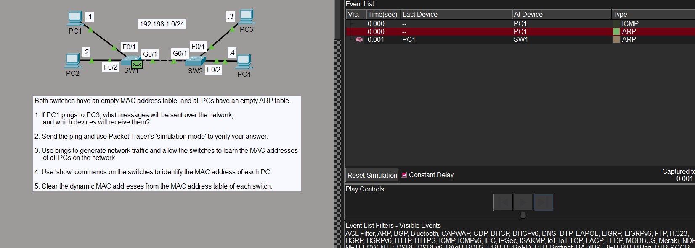
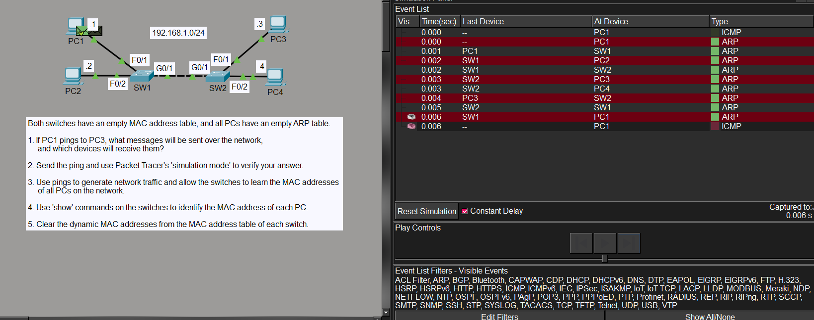
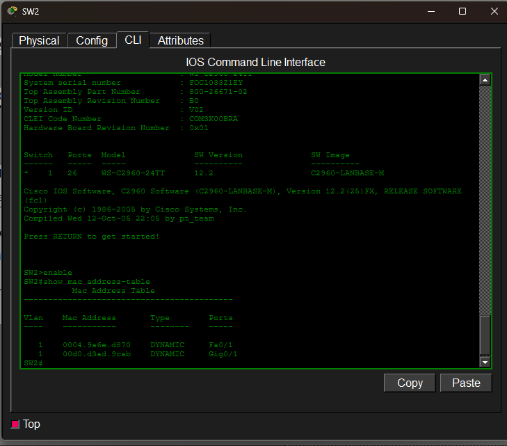
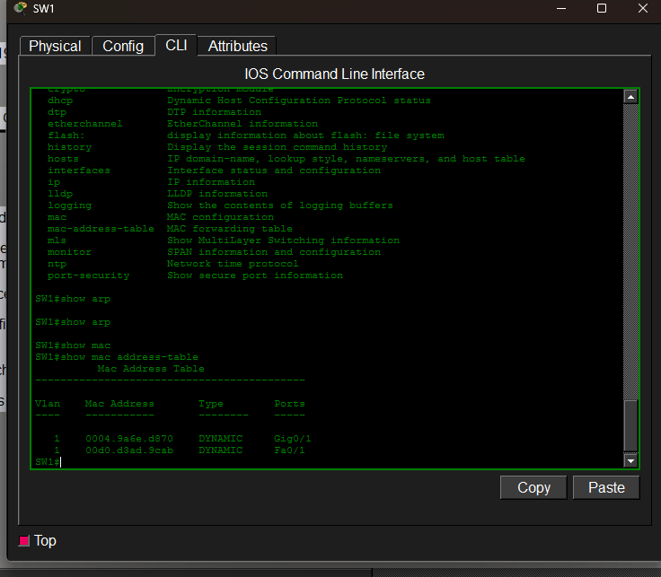
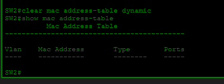
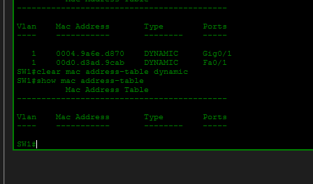

# Работа ARP и таблицы MAC-адресов на коммутаторах Cisco

Лабораторная работа по изучению принципов работы протокола ARP, динамического обучения коммутаторов (MAC Address Table) и анализа прохождения трафика в режиме симуляции Cisco Packet Tracer.

## Топология



* **Сеть:** `192.168.1.0/24`
* **Устройства:** 2 коммутатора (`SW1`, `SW2` — Cisco 2960), 4 ПК:
  * `PC1` (`192.168.1.1`) → `SW1 Fa0/1`
  * `PC2` (`192.168.1.2`) → `SW1 Fa0/2`
  * `SW1 G0/1` ↔ `SW2 G0/1`
  * `PC3` (`192.168.1.3`) → `SW2 Fa0/1`
  * `PC4` (`192.168.1.4`) → `SW2 Fa0/2`
* **Исходное состояние:** таблицы MAC-адресов на обоих коммутаторах и ARP-таблицы на всех ПК пусты.

## Задачи

1. Описать, какие сообщения будут отправлены по сети и какие устройства их получат при пинге с `PC1` на `PC3`.
2. Проверить своё предположение в режиме симуляции (`Simulation Mode`) в Packet Tracer.
3. Сгенерировать трафик с помощью `ping`, чтобы коммутаторы выучили MAC-адреса устройств.
4. С помощью `show`-команд определить MAC-адреса ПК в таблицах коммутации.
5. Очистить динамические записи из таблиц MAC-адресов на обоих коммутаторах.

## 1. Разбор процесса (`ping` с PC1 на PC3)

Чтобы `PC1` смог отправить **ICMP Echo Request** на `PC3`, ему сначала нужно узнать MAC-адрес получателя с помощью протокола **ARP**:

1. **ARP Request (Broadcast):**
   * `PC1` формирует широковещательный `ARP Request` (`Destination MAC: FFFF.FFFF.FFFF`) с вопросом, кому принадлежит IP `192.168.1.3`, и отправляет его на `SW1`.
   * `SW1` принимает кадр на порту `Fa0/1`, динамически добавляет **MAC-адрес отправителя (`PC1`)** в свою таблицу коммутации и рассылает (флудит) широковещательный кадр на все остальные интерфейсы (`Fa0/2` и `G0/1`).
   * `PC2` получает запрос и отбрасывает его, так как его IP-адрес (`192.168.1.2`) не совпадает с целевым (`192.168.1.3`).
   * Кадр доходит до `SW2` через порт `G0/1`. `SW2` динамически заносит в свою таблицу коммутации **MAC-адрес `PC1`** за портом `G0/1` (коммутаторы L2 не меняют MAC-адреса в кадре) и также флудит широковещательный запрос на все остальные порты (`Fa0/1` и `Fa0/2`).
   * `PC4` отбрасывает запрос (несовпадение IP), а `PC3` принимает его и запоминает связку IP/MAC для `PC1` в своей ARP-таблице.

2. **ARP Reply (Unicast):**
   * `PC3` отвечает адресным (`unicast`) сообщением `ARP Reply` на MAC-адрес `PC1`.
   * `SW2` принимает ответ на `Fa0/1`, динамически записывает **MAC-адрес `PC3`** в свою таблицу и отправляет кадр строго в порт `G0/1` (так как путь к `PC1` ему уже известен).
   * `SW1` принимает кадр на `G0/1`, добавляет **MAC-адрес `PC3`** в свою таблицу и пересылает его строго на `Fa0/1` к `PC1`.

3. **ICMP Echo Request / Echo Reply (Unicast):**
   * Получив `ARP Reply`, `PC1` обновляет свою ARP-таблицу и отправляет **ICMP Echo Request** напрямую на `PC3` (`PC1 → SW1 → SW2 → PC3`).
   * `PC3` отвечает **ICMP Echo Reply** в обратном направлении (`PC3 → SW2 → SW1 → PC1`). Поскольку таблицы коммутации уже заполнены, флудинга больше не происходит.

## 2. Проверка в Simulation Mode



Симуляция в Packet Tracer полностью подтвердила описанный порядок:
* `0.001s` — `ARP Request` от `PC1` приходит на `SW1`.
* `0.002s` — `SW1` рассылает его на `PC2` (отброшен) и `SW2`.
* `0.003s` — `SW2` рассылает его на `PC4` (отброшен) и `PC3` (принят).
* `0.004s – 0.006s` — `ARP Reply` возвращается юникастом `PC3 → SW2 → SW1 → PC1`, после чего `PC1` отправляет `ICMP`.

## 3. Просмотр и очистка таблиц MAC-адресов

### Таблица MAC-адресов на `SW1`

```cisco
SW1# show mac address-table
          Mac Address Table
-------------------------------------------

Vlan    Mac Address       Type        Ports
----    -----------       --------    -----
   1    0004.9a6e.d870    DYNAMIC     Gig0/1
   1    00d0.d3ad.9cab    DYNAMIC     Fa0/1
```



### Таблица MAC-адресов на `SW2`

```cisco
SW2# show mac address-table
          Mac Address Table
-------------------------------------------

Vlan    Mac Address       Type        Ports
----    -----------       --------    -----
   1    0004.9a6e.d870    DYNAMIC     Fa0/1
   1    00d0.d3ad.9cab    DYNAMIC     Gig0/1
```



### Определённые MAC-адреса устройств

| Устройство | IP-адрес | MAC-адрес | Порт подключения |
| :--- | :--- | :--- | :--- |
| `PC1` | `192.168.1.1` | `00d0.d3ad.9cab` | `SW1 Fa0/1` |
| `PC3` | `192.168.1.3` | `0004.9a6e.d870` | `SW2 Fa0/1` |

### Очистка динамических записей

Команда выполняется на обоих коммутаторах (`SW1` и `SW2`):

```cisco
SW2# clear mac address-table dynamic
SW2# show mac address-table
          Mac Address Table
-------------------------------------------

Vlan    Mac Address       Type        Ports
----    -----------       --------    -----

SW2#
```


