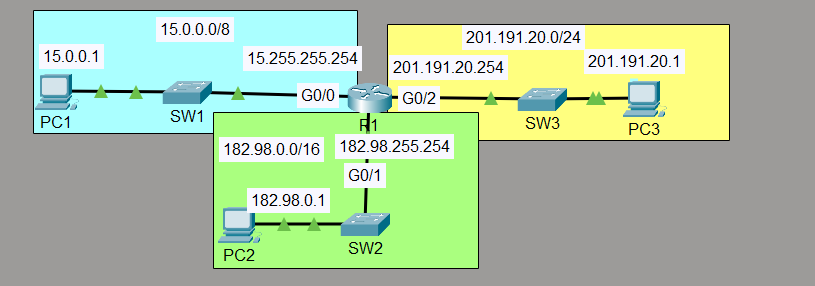

# Настройка интерфейсов маршрутизатора Cisco и маршрутизация между подсетями

Лабораторная работа по базовой настройке интерфейсов маршрутизатора Cisco IOS: назначение IPv4-адресов для сетей классов A, B и C, включение интерфейсов (`no shutdown`), добавление описаний (`description`), настройка конечных узлов и проверка связности между разными подсетями.

## Топология и адресация



* **Сети:**
  * `15.0.0.0/8` (подсеть `SW1` / `PC1`)
  * `182.98.0.0/16` (подсеть `SW2` / `PC2`)
  * `201.191.20.0/24` (подсеть `SW3` / `PC3`)
* **Среда:** Cisco Packet Tracer

### Таблица адресации

| Устройство | Интерфейс | IPv4-адрес | Маска подсети | Шлюз по умолчанию | Описание |
| :--- | :--- | :--- | :--- | :--- | :--- |
| `R1` | `GigabitEthernet0/0` | `15.255.255.254` | `255.0.0.0` (`/8`) | — | `## to SW1 ##` |
| `R1` | `GigabitEthernet0/1` | `182.98.255.254` | `255.255.0.0` (`/16`) | — | `## to SW2 ##` |
| `R1` | `GigabitEthernet0/2` | `201.191.20.254` | `255.255.255.0` (`/24`) | — | `## to SW3 ##` |
| `PC1` | `FastEthernet0` | `15.0.0.1` | `255.0.0.0` | `15.255.255.254` | — |
| `PC2` | `FastEthernet0` | `182.98.0.1` | `255.255.0.0` | `182.98.255.254` | — |
| `PC3` | `FastEthernet0` | `201.191.20.1` | `255.255.255.0` | `201.191.20.254` | — |

## Задачи

1. Настроить имя маршрутизатора (`R1`).
2. Проверить исходный список и состояние интерфейсов `R1` командой `show`.
3. Настроить IP-адреса, включить интерфейсы и задать для них описания (`description`).
4. Повторно проверить состояние интерфейсов командой `show`.
5. Проверить применённые настройки в `running-config`.
6. Настроить IP-адреса, маски и шлюзы по умолчанию на `PC1`, `PC2` и `PC3`.
7. Проверить связность между подсетями с помощью `ping` от `PC1` до `PC2` и `PC3`.

## 1. Исходное состояние интерфейсов `R1`

По умолчанию интерфейсы маршрутизатора Cisco не имеют IP-адресов и находятся в состоянии `administratively down`:

```cisco
R1# show ip interface brief
Interface              IP-Address      OK? Method Status                Protocol
GigabitEthernet0/0     unassigned      YES unset  administratively down down
GigabitEthernet0/1     unassigned      YES unset  administratively down down
GigabitEthernet0/2     unassigned      YES unset  administratively down down
Vlan1                  unassigned      YES unset  administratively down down
```


## 2. Конфигурация маршрутизатора `R1`

```cisco
Router> enable
Router# configure terminal
Router(config)# hostname R1

R1(config)# interface GigabitEthernet0/0
R1(config-if)# description ## to SW1 ##
R1(config-if)# ip address 15.255.255.254 255.0.0.0
R1(config-if)# no shutdown
R1(config-if)# exit

R1(config)# interface GigabitEthernet0/1
R1(config-if)# description ## to SW2 ##
R1(config-if)# ip address 182.98.255.254 255.255.0.0
R1(config-if)# no shutdown
R1(config-if)# exit

R1(config)# interface GigabitEthernet0/2
R1(config-if)# description ## to SW3 ##
R1(config-if)# ip address 201.191.20.254 255.255.255.0
R1(config-if)# no shutdown
R1(config-if)# end
```

## 3. Проверка конфигурации `R1`

### Состояние интерфейсов (`show ip interface brief`)

Все три настроенных интерфейса перешли в состояние `up / up`:

```cisco
R1# show ip interface brief
Interface              IP-Address      OK? Method Status                Protocol
GigabitEthernet0/0     15.255.255.254  YES manual up                    up
GigabitEthernet0/1     182.98.255.254  YES manual up                    up
GigabitEthernet0/2     201.191.20.254  YES manual up                    up
Vlan1                  unassigned      YES unset  administratively down down
```


### Текущая конфигурация (`show running-config`)

```cisco
interface GigabitEthernet0/0
 description ## to SW1 ##
 ip address 15.255.255.254 255.0.0.0
 duplex auto
 speed auto
!
interface GigabitEthernet0/1
 description ## to SW2 ##
 ip address 182.98.255.254 255.255.0.0
 duplex auto
 speed auto
!
interface GigabitEthernet0/2
 description ## to SW3 ##
 ip address 201.191.20.254 255.255.255.0
 duplex auto
 speed auto
```


## 4. Настройка ПК и проверка связности

На `PC1`, `PC2` и `PC3` настроены статические IPv4-адреса, соответствующие маски подсетей и шлюзы по умолчанию (IP-адреса интерфейсов `R1` в их подсетях):


### Проверка `ping` с `PC1` (`15.0.0.1`) на `PC3` (`201.191.20.1`)

```text
C:\>ping 201.191.20.1

Pinging 201.191.20.1 with 32 bytes of data:

Reply from 201.191.20.1: bytes=32 time<1ms TTL=127
Reply from 201.191.20.1: bytes=32 time<1ms TTL=127
Reply from 201.191.20.1: bytes=32 time<1ms TTL=127
Reply from 201.191.20.1: bytes=32 time<1ms TTL=127

Ping statistics for 201.191.20.1:
    Packets: Sent = 4, Received = 4, Lost = 0 (0% loss),
Approximate round trip times in milli-seconds:
    Minimum = 0ms, Maximum = 0ms, Average = 0ms
```


Значение `TTL=127` подтверждает, что пакеты успешно маршрутизируются через `R1` (уменьшение исходного `TTL=128` на единицу).