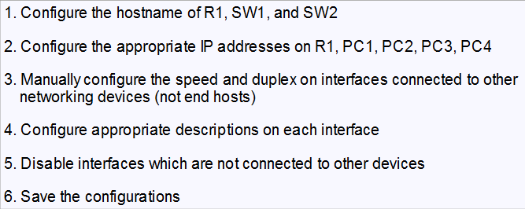

# Настройка интерфейсов коммутаторов Cisco: speed, duplex, описания и отключение портов

Лабораторная работа по настройке интерфейсов маршрутизатора и коммутаторов Cisco IOS: назначение имён устройств, IPv4-адресация, ручная настройка скорости (`speed`) и режима дуплекса (`duplex`) на межузловых линках, добавление описаний (`description`), отключение неиспользуемых портов через `interface range` и сохранение конфигурации.

## Задание



1. Настроить имена устройств (`R1`, `SW1`, `SW2`).
2. Настроить IP-адреса на `R1`, `PC1`, `PC2`, `PC3`, `PC4`.
3. Вручную задать `speed` и `duplex` на интерфейсах, подключённых к другим сетевым устройствам (не к конечным хостам).
4. Настроить понятные описания (`description`) на всех интерфейсах.
5. Административно отключить (`shutdown`) все неиспользуемые интерфейсы.
6. Сохранить конфигурации в NVRAM (`startup-config`).

## Таблица адресации и подключений

* **Сеть:** `172.16.0.0/16` (`255.255.0.0`)
* **Среда:** Cisco Packet Tracer

| Устройство | Интерфейс | IPv4-адрес / Маска | Подключение / Описание | Режим `speed` / `duplex` |
| :--- | :--- | :--- | :--- | :--- |
| `R1` | `GigabitEthernet0/0` | `172.16.255.254/16` | `## to SW1 ##` | `1000` / `full` |
| `R1` | `GigabitEthernet0/1–0/2` | — | `## disabled ##` | `shutdown` |
| `SW1` | `GigabitEthernet0/1` | — | `## to R1 ##` | `1000` / `full` |
| `SW1` | `GigabitEthernet0/2` | — | `## to SW2 ##` | `1000` / `full` |
| `SW1` | `FastEthernet0/1–0/2` | — | `## to end hosts ##` | `auto` / `auto` |
| `SW1` | `FastEthernet0/3–0/24` | — | `## disabled ##` | `shutdown` |
| `SW2` | `GigabitEthernet0/1` | — | `## to SW1 ##` | `1000` / `full` |
| `SW2` | `GigabitEthernet0/2` | — | `## disabled ##` | `shutdown` |
| `SW2` | `FastEthernet0/1–0/2` | — | `## to end hosts ##` | `auto` / `auto` |
| `SW2` | `FastEthernet0/3–0/24` | — | `## disabled ##` | `shutdown` |
| `PC1` | `FastEthernet0` | `172.16.0.1/16` | Шлюз: `172.16.255.254` | `auto` / `auto` |

*(Остальные хосты `PC2`–`PC4` настраиваются аналогично в подсети `172.16.0.0/16` с маской `255.255.0.0` и шлюзом `172.16.255.254`.)*

## 1. Конфигурация маршрутизатора `R1`

```cisco
Router> enable
Router# configure terminal
Router(config)# hostname R1

R1(config)# interface GigabitEthernet0/0
R1(config-if)# description ## to SW1 ##
R1(config-if)# ip address 172.16.255.254 255.255.0.0
R1(config-if)# speed 1000
R1(config-if)# duplex full
R1(config-if)# no shutdown
R1(config-if)# exit

R1(config)# interface range GigabitEthernet0/1 - 2
R1(config-if-range)# description ## disabled ##
R1(config-if-range)# shutdown
R1(config-if-range)# end

R1# copy running-config startup-config
```


> **Примечание:** После ручной установки `speed 1000` на `R1 G0/0` протокол канала временно перешёл в состояние `up / down`, так как на ответном порту `SW1 G0/1` всё ещё работало автосогласование. После задания аналогичных параметров `speed 1000` и `duplex full` на `SW1 G0/1` линк снова поднялся в `up / up`.

## 2. Конфигурация коммутаторов `SW1` и `SW2`

### Коммутатор `SW1`

```cisco
Switch> enable
Switch# configure terminal
Switch(config)# hostname SW1

SW1(config)# interface range GigabitEthernet0/1 - 2
SW1(config-if-range)# speed 1000
SW1(config-if-range)# duplex full
SW1(config-if-range)# exit

SW1(config)# interface GigabitEthernet0/1
SW1(config-if)# description ## to R1 ##
SW1(config-if)# exit

SW1(config)# interface GigabitEthernet0/2
SW1(config-if)# description ## to SW2 ##
SW1(config-if)# exit

SW1(config)# interface range FastEthernet0/1 - 2
SW1(config-if-range)# description ## to end hosts ##
SW1(config-if-range)# speed auto
SW1(config-if-range)# duplex auto
SW1(config-if-range)# exit

SW1(config)# interface range FastEthernet0/3 - 24
SW1(config-if-range)# description ## disabled ##
SW1(config-if-range)# shutdown
SW1(config-if-range)# end

SW1# copy running-config startup-config
```


### Коммутатор `SW2`

```cisco
Switch> enable
Switch# configure terminal
Switch(config)# hostname SW2

SW2(config)# interface GigabitEthernet0/1
SW2(config-if)# description ## to SW1 ##
SW2(config-if)# speed 1000
SW2(config-if)# duplex full
SW2(config-if)# exit

SW2(config)# interface GigabitEthernet0/2
SW2(config-if)# description ## disabled ##
SW2(config-if)# shutdown
SW2(config-if)# exit

SW2(config)# interface range FastEthernet0/1 - 2
SW2(config-if-range)# description ## to end hosts ##
SW2(config-if-range)# speed auto
SW2(config-if-range)# duplex auto
SW2(config-if-range)# exit

SW2(config)# interface range FastEthernet0/3 - 24
SW2(config-if-range)# description ## disabled ##
SW2(config-if-range)# shutdown
SW2(config-if-range)# end

SW2# copy running-config startup-config
```

### Возврат автосогласования на портах конечных хостов (`SW1` и `SW2`)

Чтобы избежать `duplex mismatch` при подключении к конечным узлам с активным автосогласованием, на портах `Fa0/1–Fa0/2` обоих коммутаторов выставлены `speed auto` и `duplex auto`:


## 3. Настройка ПК и проверка статусов интерфейсов

### Настройка `PC1`


### Проверка интерфейсов на `SW2` (`show interface status`)

```cisco
SW2# show interface status
Port      Name               Status       Vlan       Duplex  Speed Type
Fa0/1     ## to end hosts ## connected    1          a-full  a-100 10/100BaseTX
Fa0/2     ## to end hosts ## connected    1          a-full  a-100 10/100BaseTX
Fa0/3     ## disabled ##     disabled     1          auto    auto  10/100BaseTX
...
Fa0/24    ## disabled ##     disabled     1          auto    auto  10/100BaseTX
Gig0/1    ## to SW1 ##       connected    1          full    1000  10/100/1000BaseTX
Gig0/2    ## disabled ##     disabled     1          auto    auto  10/100/1000BaseTX
```

