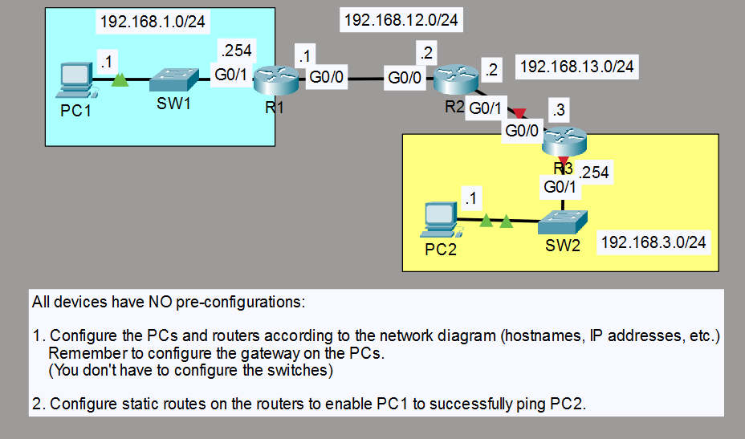

# Статическая маршрутизация (Static Routing) в Cisco IOS

Лабораторная работа по настройке статической маршрутизации между тремя маршрутизаторами Cisco IOS: настройка интерфейсов, параметров IPv4 и шлюзов по умолчанию на конечных хостах, добавление статических маршрутов (`ip route`) через IP-адрес следующего перехода (`next-hop`), анализ таблиц маршрутизации (`show ip route`) и проверка связности.

## Топология



* **Среда:** Cisco Packet Tracer
* **Сети:**
  * `192.168.1.0/24` — локальная сеть `PC1`
  * `192.168.12.0/24` — транзитный линк `R1 ↔ R2`
  * `192.168.13.0/24` — транзитный линк `R2 ↔ R3`
  * `192.168.3.0/24` — локальная сеть `PC2`

## Таблица адресации

| Устройство | Интерфейс | IPv4-адрес | Маска подсети | Шлюз по умолчанию |
| :--- | :--- | :--- | :--- | :--- |
| `PC1` | `FastEthernet0` | `192.168.1.1` | `255.255.255.0` | `192.168.1.254` |
| `R1` | `GigabitEthernet0/1` | `192.168.1.254` | `255.255.255.0` | — |
| `R1` | `GigabitEthernet0/0` | `192.168.12.1` | `255.255.255.0` | — |
| `R2` | `GigabitEthernet0/0` | `192.168.12.2` | `255.255.255.0` | — |
| `R2` | `GigabitEthernet0/1` | `192.168.13.2` | `255.255.255.0` | — |
| `R3` | `GigabitEthernet0/0` | `192.168.13.3` | `255.255.255.0` | — |
| `R3` | `GigabitEthernet0/1` | `192.168.3.254` | `255.255.255.0` | — |
| `PC2` | `FastEthernet0` | `192.168.3.1` | `255.255.255.0` | `192.168.3.254` |

## 1. Настройка интерфейсов маршрутизаторов

### Маршрутизатор `R1`

```cisco
R1(config)# interface GigabitEthernet0/1
R1(config-if)# ip address 192.168.1.254 255.255.255.0
R1(config-if)# no shutdown
R1(config-if)# interface GigabitEthernet0/0
R1(config-if)# ip address 192.168.12.1 255.255.255.0
R1(config-if)# no shutdown
```


### Маршрутизатор `R2`

```cisco
Router(config)# hostname R2
R2(config)# interface GigabitEthernet0/0
R2(config-if)# ip address 192.168.12.2 255.255.255.0
R2(config-if)# no shutdown
R2