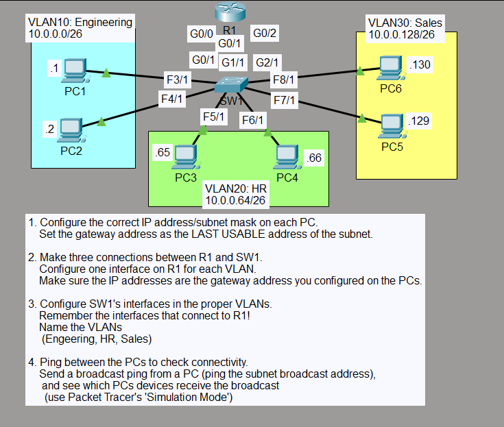

# Настройка VLAN и маршрутизация между VLAN (Inter-VLAN Routing)

Лабораторная работа по сегментации локальной сети на уровне доступа с использованием **VLAN** на коммутаторе `SW1` (`VLAN 10`, `VLAN 20`, `VLAN 30`), разбиению адресного пространства `10.0.0.0/24` на подсети `/26`, организации маршрутизации между VLAN через отдельные физические интерфейсы маршрутизатора `R1` и проверке изоляции широковещательных доменов.

## Топология и задание



* **Среда:** Cisco Packet Tracer
* **Базовая сеть:** `10.0.0.0/24` (подсети `/26`, маска `255.255.255.192`)

**Задачи:**
1. Настроить IP-адреса и маски подсети на `PC1`–`PC6`; в качестве шлюза по умолчанию задать **последний доступный** IP-адрес соответствующей подсети.
2. Подключить `R1` к `SW1` тремя отдельными линками и настроить на `R1` по одному интерфейсу-шлюзу для каждого VLAN.
3. Назначить порты `SW1` (включая аплинки к `R1`) в соответствующие VLAN и задать имена (`Engineering`, `HR`, `Sales`).
4. Проверить связность между ПК из разных VLAN и выполнить широковещательный `ping` (на broadcast-адрес подсети), чтобы убедиться в изоляции широковещательных доменов.

## Таблица VLAN и подсетей

| VLAN ID | Имя VLAN | Подсеть | Маска подсети | Шлюз (`R1`) | Broadcast-адрес | Порты `SW1` |
| :---: | :--- | :--- | :--- | :--- | :--- | :--- |
| `10` | `Engineering` | `10.0.0.0/26` | `255.255.255.192` | `10.0.0.62` | `10.0.0.63` | `Gig0/1`, `Fa3/1`, `Fa4/1` |
| `20` | `HR` | `10.0.0.64/26` | `255.255.255.192` | `10.0.0.126` | `10.0.0.127` | `Gig1/1`, `Fa5/1`, `Fa6/1` |
| `30` | `Sales` | `10.0.0.128/26` | `255.255.255.192` | `10.0.0.190` | `10.0.0.191` | `Gig2/1`, `Fa7/1`, `Fa8/1` |

## Таблица адресации устройств

| Устройство | Интерфейс / Порт `SW1` | VLAN | IPv4-адрес | Маска подсети | Шлюз по умолчанию |
| :--- | :--- | :---: | :--- | :--- | :--- |
| `R1` | `GigabitEthernet0/0` (`SW1 Gig0/1`) | `10` | `10.0.0.62` | `255.255.255.192` | — |
| `R1` | `GigabitEthernet0/1` (`SW1 Gig1/1`) | `20` | `10.0.0.126` | `255.255.255.192` | — |
| `R1` | `GigabitEthernet0/2` (`SW1 Gig2/1`) | `30` | `10.0.0.190` | `255.255.255.192` | — |
| `PC1` | `FastEthernet0` (`SW1 Fa3/1`) | `10` | `10.0.0.1` | `255.255.255.192` | `10.0.0.62` |
| `PC2` | `FastEthernet0` (`SW1 Fa4/1`) | `10` | `10.0.0.2` | `255.255.255.192` | `10.0.0.62` |
| `PC3` | `FastEthernet0` (`SW1 Fa5/1`) | `20` | `10.0.0.65` | `255.255.255.192` | `10.0.0.126` |
| `PC4` | `FastEthernet0` (`SW1 Fa6/1`) | `20` | `10.0.0.66` | `255.255.255.192` | `10.0.0.126` |
| `PC5` | `FastEthernet0` (`SW1 Fa7/1`) | `30` | `10.0.0.129` | `255.255.255.192` | `10.0.0.190` |
| `PC6` | `FastEthernet0` (`SW1 Fa8/1`) | `30` | `10.0.0.130` | `255.255.255.192` | `10.0.0.190` |

---

## 1. Настройка конечных узлов (`PC1`–`PC6`)

### VLAN 10 (`Engineering` — `10.0.0.0/26`, шлюз `10.0.0.62`)


### VLAN 20 (`HR` — `10.0.0.64/26`, шлюз `10.0.0.126`)


### VLAN 30 (`Sales` — `10.0.0.128/26`, шлюз `10.0.0.190`)


---

## 2. Настройка интерфейсов маршрутизатора `R1`

На маршрутизаторе `R1` назначены IP-адреса шлюзов по умолчанию для каждой из трёх подсетей, после чего все три интерфейса одновременно включены через `interface range`:

```cisco
R1(config)# interface GigabitEthernet0/0
R1(config-if)# ip address 10.0.0.62 255.255.255.192
R1(config-if)# interface GigabitEthernet0/1
R1(config-if)# ip address 10.0.0.126 255.255.255.192
R1(config-if)# interface GigabitEthernet0/2
R1(config-if)# ip address 10.0.0.190 255.255.255.192
R1(config-if)# interface range GigabitEthernet0/0 - 2
R1(config-if-range)# no shutdown
```

Проверка состояния интерфейсов (`show ip interface brief`):

```cisco
Interface              IP-Address      OK? Method Status                Protocol
GigabitEthernet0/0     10.0.0.62       YES manual up                    up
GigabitEthernet0/1     10.0.0.126      YES manual up                    up
GigabitEthernet0/2     10.0.0.190      YES manual up                    up
```


---

## 3. Настройка VLAN и портов доступа на коммутаторе `SW1`

### Назначение аплинков к `R1` и автоматическое создание VLAN

При назначении портов `Gig0/1`, `Gig1/1` и `Gig2/1` в несуществующие VLAN 10, 20 и 30 Cisco IOS автоматически создаёт соответствующие VLAN:

```cisco
SW1(config)# interface GigabitEthernet0/1
SW1(config-if)# switchport mode access
SW1(config-if)# switchport access vlan 10
SW1(config-if)# interface GigabitEthernet1/1
SW1(config-if)# switchport mode access
SW1(config-if)# switchport access vlan 20
SW1(config-if)# interface GigabitEthernet2/1
SW1(config-if)# switchport mode access
SW1(config-if)# switchport access vlan 30
```


### Именование VLAN

```cisco
SW1(config)# vlan 10
SW1(config-vlan)# name Engineering
SW1(config-vlan)# vlan 20
SW1(config-vlan)# name HR
SW1(config-vlan)# vlan 30
SW1(config-vlan)# name Sales
```


### Назначение портов конечных узлов (`PC1`–`PC6`)

```cisco
SW1(config)# interface range FastEthernet3/1, FastEthernet4/1
SW1(config-if-range)# switchport mode access
SW1(config-if-range)# switchport access vlan 10
SW1(config-if-range)# interface range FastEthernet5/1, FastEthernet6/1
SW1(config-if-range)# switchport mode access
SW1(config-if-range)# switchport access vlan 20
SW1(config-if-range)# interface range FastEthernet7/1, FastEthernet8/1
SW1(config-if-range)# switchport mode access
SW1(config-if-range)# switchport access vlan 30
```

Итоговая таблица VLAN (`show vlan brief`):

```cisco
VLAN Name                             Status    Ports
---- -------------------------------- --------- -------------------------------
1    default                          active    Fa9/1
10   Engineering                      active    Gig0/1, Fa3/1, Fa4/1
20   HR                               active    Gig1/1, Fa5/1, Fa6/1
30   Sales                            active    Gig2/1, Fa7/1, Fa8/1
```


---

## 4. Проверка связности и широковещательных доменов

### Межсетевая связность (Inter-VLAN Ping)

Проверка `ping` с `PC1` (`10.0.0.1`, `VLAN 10`) на узлы `VLAN 30` (`PC6` `10.0.0.130` и `PC5` `10.0.0.129`). После первого таймаута на ARP-разрешение все пакеты проходят с `0% loss`, а `TTL=127` подтверждает маршрутизацию через `R1`:


### Проверка изоляции широковещательных доменов (Broadcast Ping)

При отправке ICMP-запросов на широковещательный адрес своей подсети ответы приходят **только от устройств внутри того же VLAN** (соседний ПК с `TTL=128` и шлюз `R1` с `TTL=255`). Маршрутизатор не пересылает широковещательный трафик в другие VLAN:

* **VLAN 10 (`PC2` → `10.0.0.63`):** ответили только `PC1` (`10.0.0.1`) и `R1 G0/0` (`10.0.0.62`):

  

* **VLAN 20 (`PC3` → `10.0.0.127`):** ответили только `PC4` (`10.0.0.66`) и `R1 G0/1` (`10.0.0.126`):

  

* **VLAN 30 (`PC5` → `10.0.0.191`):** ответили только `PC6` (`10.0.0.130`) и `R1 G0/2` (`10.0.0.190`):

  